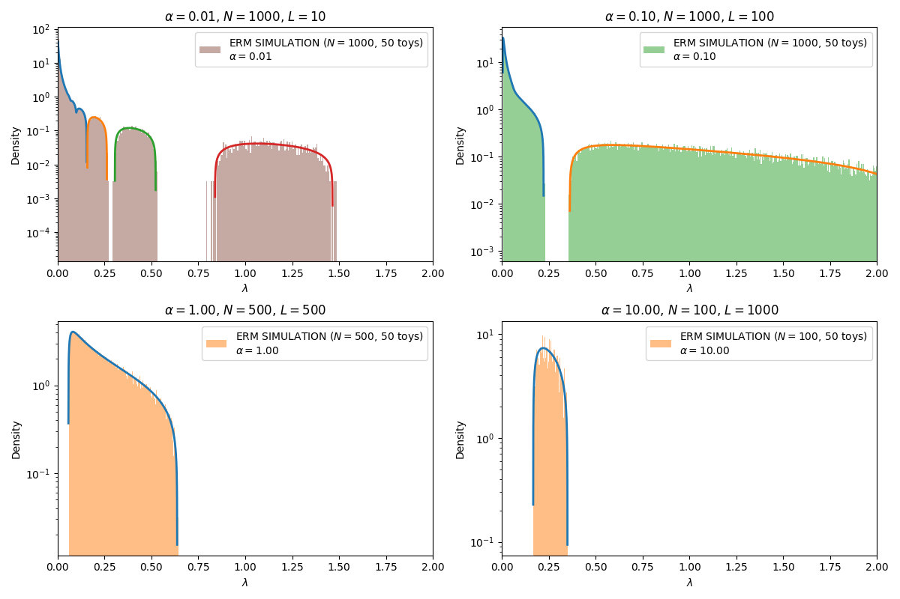
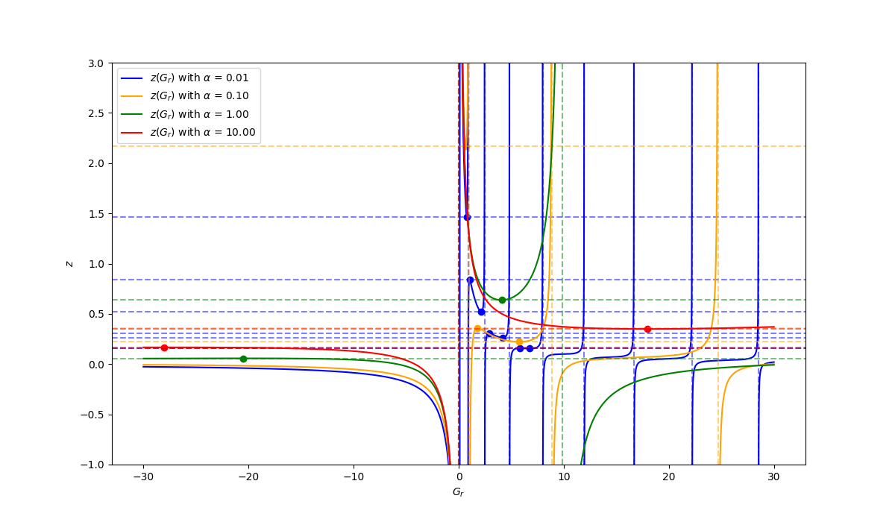

# Spectral Analysis of Euclidean Random Matrices via Replicas

**Livio Lando** · Bachelor's thesis in Physics · University of Milano-Bicocca, Milan, Italy  
**External supervisor** · Pierpaolo Vivo, King's College London  
**Internal supervisor** · Silvia Penati, University of Milano-Bicocca

What happens to the eigenvalues of a distance matrix when the same points are rearranged on a ring, over and over, and the resulting matrices are averaged? In this thesis I derive a prediction for the eigenvalue density and test it by diagonalising random matrices in Python. At low numbers of maps per site, the spectrum retains distinct bands associated with the geometry of the ring. As the number of maps per site increases, the gaps close and the bulk concentrates around a predictable value.



*Each panel compares eigenvalues pooled from 50 independent matrices (shaded histogram) with the density obtained from the replica calculation (solid curves). Read from top left to bottom right as the load increases. The common window shows eigenvalues between 0 and 2, so the highest band at the smallest load lies outside the frame.*

## From one spatial map to many

A map assigns each of $N$ labelled sites an independent, uniformly sampled position on a ring of circumference one. A pair of sites at shortest-arc distance $d$ interacts through the linear kernel $f(d)=\phi_0-d$. In the neural interpretation of the Battista–Monasson model, a site represents a place cell and its position is the centre of its place field in one environment. Sampling a new map gives the same cells a new spatial arrangement.

For one map, I study the matrix with entries $X^{(1)}_{ij}=f(d_{ij})/N$. Its continuum eigenfunctions are Fourier modes. Each odd harmonic $m>0$ contributes a sine–cosine pair with the same eigenvalue $1/(\pi m)^2$. In a finite sample the two eigenvalues can split. Each pair carries weight $2/N$ in the empirical density, so individual peaks can remain visible even as the normalised spectral measure of the centred matrix converges to a point mass at zero.

For $L$ independent maps, I study the map average and take $N$ and $L$ large at fixed load $\alpha=L/N$,

$$
C^{(L)}_{ij}=\frac{1}{L}\sum_{\ell=1}^{L} f\bigl(d_{ij}^{(\ell)}\bigr).
$$

The spatial average of the kernel, $\phi_0-1/4$, contributes a rank-one matrix that can produce an isolated eigenvalue. Subtracting this constant from the kernel leaves the centred matrix whose bulk spectrum is the focus of the analysis.

## Predicting the spectral bands

I use the Edwards–Jones formula and the replica method to express the spectrum in terms of the resolvent $G$. For the centred map average, the calculation gives an implicit equation in terms of the Fourier coefficients $\gamma_m$ of the kernel,

$$
z=B(G)=\frac{1}{G}+\sum_{m\ne 0}\frac{\alpha\gamma_m}{\alpha-\gamma_m G}.
$$

This equation gives two ways to compare theory with simulations. On the physical branch, the imaginary part gives the density through $\rho(\lambda)=\operatorname{Im}G(\lambda-i0)/\pi$. At a regular band edge the real inverse function has a turning point. I locate these points numerically by solving $B'(g)=0$ between poles and mapping the relevant roots back to eigenvalues through $\lambda=B(g)$.



*The horizontal coordinate is a real resolvent value and the vertical coordinate is the candidate eigenvalue. Reading the height of a marked turning point gives a candidate band edge. Two neighbouring edges meet when the gap between their bands closes.*

With the Fourier cutoff $|m|\leq 49$, the calculation yields **five positive continuous bands** at $\alpha=0.01$, **two** at $\alpha=0.1$, and **one** at both $\alpha=1$ and $10$. For the full centred kernel the limiting bulk has mean $1/4$ and variance $1/(48\alpha)$. These moments explain why the single band in the last panel is narrower than the one before it.

## Exploring the code

| Calculation | Script |
| --- | --- |
| Solve the complex resolvent equation and compare its density with eigenvalue histograms | [general_monasson_sol.py](teoria_RMT/general_monasson_sol.py) |
| Track band edges across ten logarithmically spaced values of the load | [forbidden_intervals.py](teoria_RMT/forbidden_intervals.py) |

To run the band-edge scan from the repository root with Python 3:

```bash
python3 -m pip install numpy scipy matplotlib seaborn
python3 teoria_RMT/forbidden_intervals.py
```

The script prints the estimated edges for each load and writes `alpha_i.png` to the current directory. Each vertical segment in that plot spans a predicted band of eigenvalues. The legend's “forbidden intervals” refers to values where the physical resolvent cannot remain real.

## Reference

Aldo Battista and Rémi Monasson, “On the spectrum of multi-space Euclidean random matrices,” *Physical Review E* **101**, 052133 (2020). [Article](https://doi.org/10.1103/PhysRevE.101.052133) · [arXiv](https://arxiv.org/abs/2003.07590)

